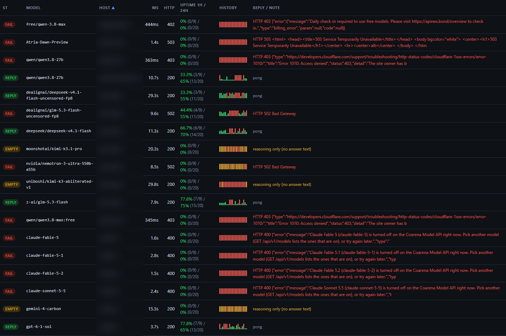

# ModelPulse

Model availability monitor for Qoder BYOK providers, with an on-demand MCP tool, a web
dashboard, and a one-shot HTML report.



---

## English

### What it is

Qoder keeps your connected providers and models in `~/.qoder/settings.json` → `providers`.
ModelPulse reads **the same file** and actively probes every model with a `chat/completions`
request ("reply with one word: pong"), verifying that **real answer text** came back, not just
HTTP 200. No IPC, no plugin — the shared registry file is the whole integration contract.

Statuses:

- **REPLY** — text came back (`pong`);
- **EMPTY** — 200 but no content (reasoning only / empty `content`);
- **FAIL** — network/HTTP error (403, 404, 429, timeout, ...).

### Modes

1. **One-shot run** — `once.cmd`. Probes every model, writes an HTML report and **opens it in a
   separate browser window**; the console window may be closed — the report stays on disk.
2. **Web monitor** — `start.cmd` runs a local server (`127.0.0.1:8765`) with a dashboard: cards,
   filter, per-model history, 1h/24h uptime, interval re-scan. A running check can be aborted
   with **Esc** or the "Cancel" button; a cancelled pass is dropped entirely and never reaches
   history or statistics.
3. **MCP tool** — `mcp_server.py` exposes a tool the agent can call to run the same pass on demand.

### Interface language

The dashboard and the report are bilingual: **RU / EN**. Toggle via the `RU | EN` segment in the
top-right corner of the dashboard; the choice is stored in `config.json → language` and applies to
the next `once.py` report. One-off override: `python once.py --lang en`.

### Requirements

- Python 3.10+ (tested on 3.14, Windows and Linux).
- Nothing else: HTTP via stdlib `urllib`, storage via stdlib `sqlite3`.

### Quick start

```bash
python once.py                 # one pass + report in the browser
python once.py --filter groq   # only matching models
python once.py --no-open       # render the report, do not launch a browser
python server.py --port 8765   # web monitor at http://127.0.0.1:8765
```

On Windows, double-click `once.cmd` / `start.cmd` instead.

### Configuration

`config.json` next to the scripts:

```json
{
  "settings_path": "",
  "interval_seconds": 900,
  "max_tokens": 16,
  "timeout_seconds": 30,
  "workers": 8,
  "language": "ru",
  "browser": ""
}
```

- `settings_path` — path to the settings file; empty = `~/.qoder/settings.json`.
- `browser` — what opens the report: a full `.exe` path **or** the words
  `firefox` / `chrome` / `edge`. Empty = the Windows default browser.
- `workers` — how many models to probe in parallel.

The browser is chosen in this order: `MODELPULSE_BROWSER` env → `config.json → browser` →
the Windows default browser (from the registry) → known install paths (Chrome, Edge, Brave,
Vivaldi, Opera, Yandex, Firefox) → the `.html` association. **Chrome is not required.**

### Reports

`data/reports/` gets `report-<timestamp>.html` per run plus `last-run.html` (always the newest);
the 50 latest are kept, older ones are pruned automatically. `data/last-run.txt` holds the same
table as text. Each report is self-contained: inline CSS, no server, opens on a double-click.

### Sources: agents on this machine

ModelPulse can find **other agents and clients** installed on the PC and pull models from them.
There is a "Sources" tab in the dashboard and a console command:

```bash
python once.py --list-sources          # agents found on this PC
python once.py --list-sources --deep   # plus a profile walk
python once.py --source zcode          # one pass against the chosen agent
```

**The user picks which agent to work with**: click an agent row in the panel to make it active, and
"Check now" runs against its models. The choice is saved to `config.json` (`active_source`) and
survives restarts.

Known-agent catalog: Qoder, zcode, Codex CLI, free-claude-code, Cline, Claude Code, Gemini CLI,
Copilot CLI, LM Studio, Ollama, Continue, Aider. Deep scan (`--deep`, or the checkbox in the panel)
also walks the profile and recognises unknown configs by their providers/models shape.

Sources come in three kinds: **agent** (a real client you use; some are probeable), **catalog**
(a model list shipped with an agent), and **registry** (metadata such as `~/.cache/kilo/models.json`
- not your config, shown as reference only and never probed).

**Security.** The inventory **never shows key values** - only a `has_key` flag and its length. Keys
are read into memory only at probe time and never written. The walk is bounded (depth 5, up to
40000 files, a size cap, pruned caches/system dirs) - not a full-disk crawl.

### MCP connector

Add a stdio server under `mcpServers` in `~/.qoder/settings.json`:

```json
{
  "mcpServers": {
    "models-ping": {
      "type": "stdio",
      "command": "python",
      "args": ["<path>/mcp_server.py"]
    }
  }
}
```

Tools: `models_providers` (list targets) and `models_status` (run a pass + summary).

### Privacy

API keys are read from your `settings.json` into memory and are **never written anywhere** —
no reports, no DB, no logs, no disk. The server binds to `127.0.0.1` only.

---

## Русский

### Что это

Qoder хранит подключённые тобой провайдеры и модели в `~/.qoder/settings.json` → `providers`.
ModelPulse читает **тот же файл** и активно прозванивает каждую модель запросом
`chat/completions` («ответь одним словом: pong»), проверяя, что пришёл **настоящий текст ответа**,
а не просто HTTP 200. Никакого IPC и никаких плагинов — общий файл-реестр и есть «контракт стыковки».

Статусы:

- **ОТВЕТ** — пришёл текст (`pong`);
- **ПУСТО** — 200, но контента нет (только reasoning / пустой `content`);
- **СБОЙ** — ошибка сети/HTTP (403, 404, 429, таймаут и т.д.).

### Режимы

1. **Разовый прогон** — `once.cmd`. Прозванивает все модели, пишет HTML-отчёт и **открывает его
   отдельным окном браузера**; окно консоли можно закрыть — отчёт остаётся на диске.
2. **Веб-монитор** — `start.cmd` поднимает локальный сервер (`127.0.0.1:8765`) с дашбордом:
   карточки, фильтр, история по каждой модели, доступность за 1ч/24ч, автоопрос по интервалу.
   Идущую проверку можно прервать: **Esc** или кнопка «Отменить». Отменённый прогон отбрасывается
   целиком — в историю и статистику он не попадает.
3. **MCP-тул** — `mcp_server.py` отдаёт инструмент агенту, который по запросу делает тот же прогон.

### Язык интерфейса

Дашборд и отчёт двуязычные: **RU / EN**. Переключатель — сегмент `RU | EN` в правом верхнем углу
панели; выбор сохраняется в `config.json → language` и применяется к следующему отчёту `once.py`.
Разово переопределить: `python once.py --lang en`.

### Требования

- Python 3.10+ (проверено на 3.14, Windows и Linux).
- Больше ничего: HTTP — через стандартный `urllib`, хранилище — стандартный `sqlite3`.

### Быстрый старт

```bash
# разовый прогон + отчёт в браузере
python once.py

# только несколько моделей
python once.py --filter wusrouter --timeout 30

# отчёт без открытия окна
python once.py --no-open

# веб-монитор на http://127.0.0.1:8765
python server.py --port 8765 --interval 900
```

На Windows то же самое двойным кликом: `once.cmd` и `start.cmd`.

### Как задать источник и браузер

`config.json` (рядом со скриптами):

```json
{
  "settings_path": "",
  "interval_seconds": 900,
  "max_tokens": 16,
  "timeout_seconds": 30,
  "workers": 8,
  "language": "ru",
  "browser": ""
}
```

- `settings_path` — путь к файлу настроек; пусто = `~/.qoder/settings.json`.
- `browser` — чем открывать отчёт: полный путь к `.exe` **или** слово
  `firefox` / `chrome` / `edge`. Пусто = браузер по умолчанию Windows.
- `workers` — сколько моделей проверять параллельно.

Браузер выбирается по порядку: переменная `MODELPULSE_BROWSER` → `config.json → browser` →
браузер по умолчанию Windows (из реестра) → известные пути (Chrome, Edge, Brave, Vivaldi,
Opera, Yandex, Firefox) → ассоциация `.html`. **Chrome не обязателен.**

### Отчёты

Разовый прогон кладёт отчёты в `data/reports/`:

- `report-<дата_время>.html` — снимок каждого прогона;
- `last-run.html` — всегда последний (удобно держать на закладке);
- хранится 50 последних, старые удаляются автоматически;
- `data/last-run.txt` — та же таблица текстом (как раньше).

Отчёт самодостаточен: весь CSS внутри, сервер не нужен, открывается двойным кликом.

### Источники: агенты на компьютере

ModelPulse умеет искать на ПК **другие агенты и клиенты** и брать модели из них. Есть вкладка
«Источники» в веб-панели и команда в консоли:

```bash
python once.py --list-sources          # список найденных агентов
python once.py --list-sources --deep   # + обход профиля
python once.py --source zcode          # разовый прогон по выбранному агенту
```

**Клиент сам выбирает, с каким агентом работать**: в панели щёлкни строку агента — он станет
активным, и «Проверить сейчас» пойдёт по его моделям. Выбор сохраняется в `config.json`
(`active_source`) и переживает перезапуск.

Каталог известных агентов: Qoder, zcode, Codex CLI, free-claude-code, Cline, Claude Code,
Gemini CLI, Copilot CLI, LM Studio, Ollama, Continue, Aider. Глубокий поиск (`--deep`, флажок
в панели) дополнительно обходит профиль и распознаёт чужие конфиги по форме провайдеров/моделей.

Источники делятся на три вида:

- **агент** — реальный клиент, ты им пользуешься; у части есть ключ и OpenAI-совместимый адрес,
  такие можно **прозванивать** (например Qoder);
- **каталог** — список моделей рядом с агентом (напр. `codex-model-catalog.json`);
- **реестр** — метаданные вроде `~/.cache/kilo/models.json`, это **не твой конфиг**, только
  справочник имён моделей; помечается явно и никогда не прозванивается.

**Безопасность.** Инвентарь **не показывает значения ключей** — только флаг «есть ключ» и его
длину. Ключи читаются в память лишь в момент прозвона и никуда не пишутся. Обход ограничен
(глубина 5, до 40000 файлов, лимит размера, пропуск кэшей и системных папок) — это не сплошное
сканирование диска.

### MCP-коннектор

В `~/.qoder/settings.json` → `mcpServers` добавь stdio-сервер:

```json
{
  "mcpServers": {
    "models-ping": {
      "type": "stdio",
      "command": "python",
      "args": ["<путь>/mcp_server.py"]
    }
  }
}
```

Инструменты: `models_providers` (список целей) и `models_status` (прогон + сводка).

### О приватности

Ключи читаются из твоего `settings.json` в память и **никуда не пишутся**: ни в отчёты,
ни в БД, ни в логи, ни на диск. Сервер слушает только `127.0.0.1`.

---

## License

MIT — see [LICENSE](LICENSE).
